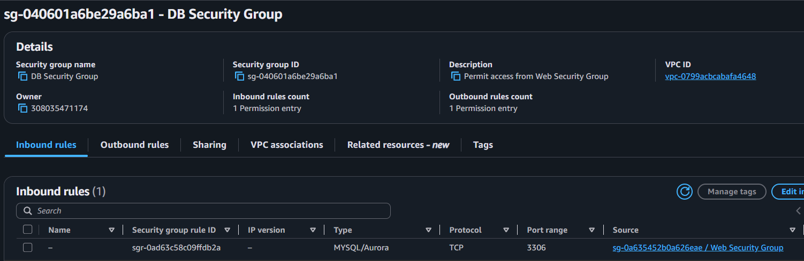
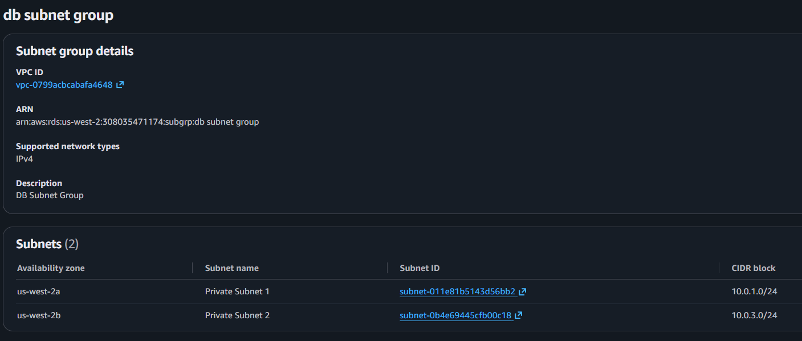
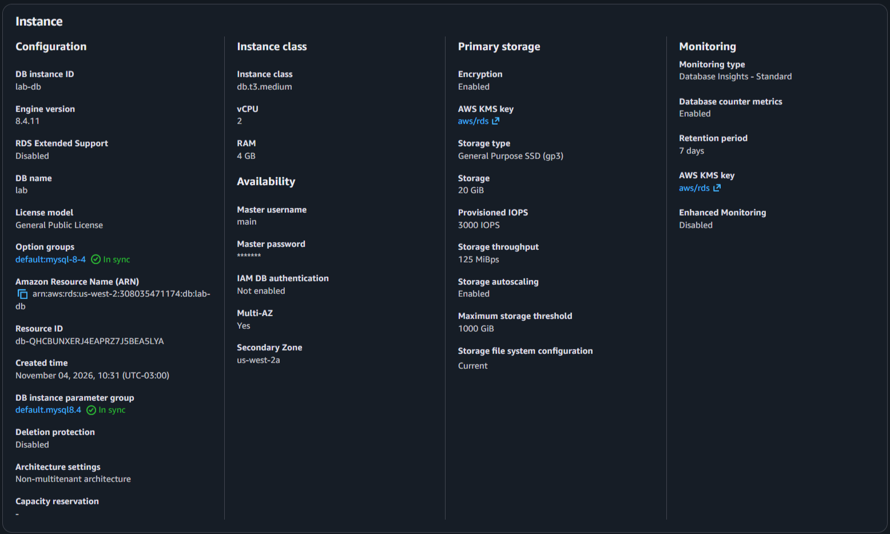
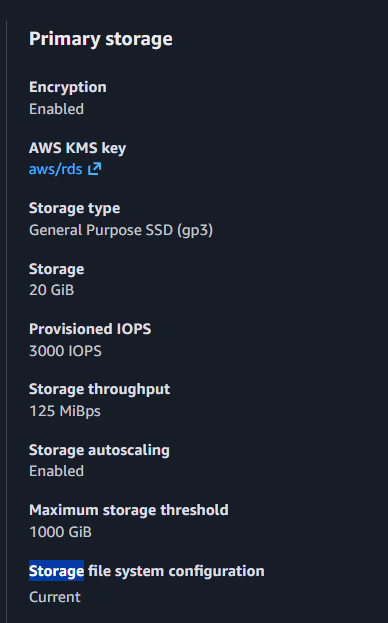
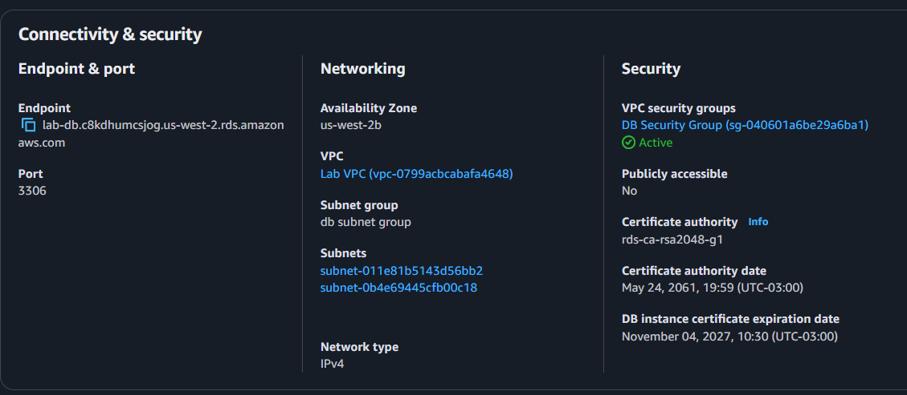
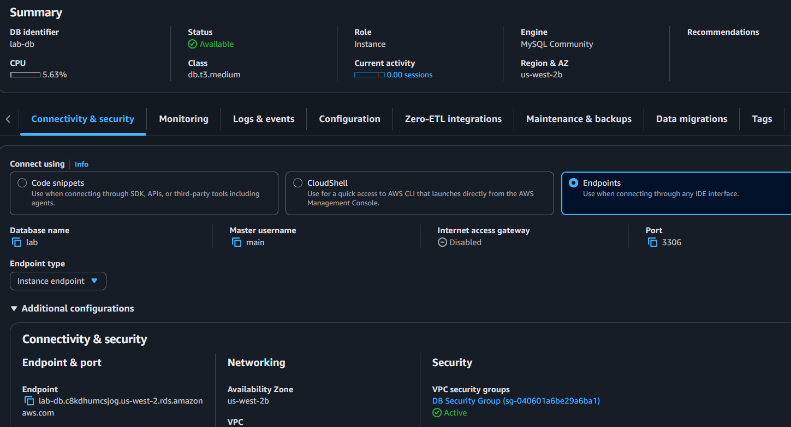
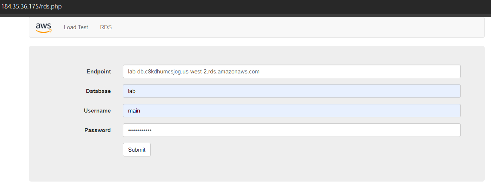
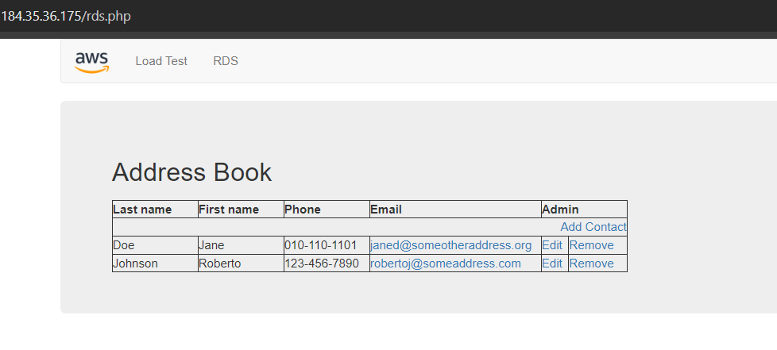

# Lab 4 - Lab 160 - Build Your DB Server and Interact With Your DB Using an App

## Visão geral

Neste laboratório, foi criada uma instância de banco de dados relacional utilizando o **Amazon Relational Database Service (Amazon RDS)** e realizada sua integração com uma aplicação web executada em uma instância Amazon EC2.

O objetivo foi configurar um banco de dados gerenciado pela AWS, permitir que o servidor web se conectasse a ele de maneira controlada e utilizar a aplicação para cadastrar, editar e remover informações.

A implantação utilizou o mecanismo **MySQL** e a configuração **Multi-AZ**, que mantém uma instância principal e uma instância em espera em outra Zona de Disponibilidade.

## Objetivos

- Criar um Security Group para controlar o acesso ao banco de dados.
- Criar um DB Subnet Group utilizando subnets privadas em duas Zonas de Disponibilidade.
- Implantar uma instância Amazon RDS para MySQL com configuração Multi-AZ.
- Configurar a conectividade entre o servidor web e o banco de dados.
- Conectar uma aplicação web ao RDS.
- Testar operações de inclusão, edição e remoção de registros.

## Conceitos fundamentais

### Amazon RDS

O **Amazon Relational Database Service (RDS)** é um serviço gerenciado da AWS que facilita a criação, configuração e operação de bancos de dados relacionais na nuvem.

Em vez de administrar manualmente toda a infraestrutura do banco de dados, o usuário pode utilizar o serviço para provisionar e gerenciar instâncias de banco de dados.

O RDS oferece suporte a diferentes mecanismos, incluindo MySQL, PostgreSQL, MariaDB, Oracle, Microsoft SQL Server e Amazon Aurora.

### MySQL

O **MySQL** é um sistema de gerenciamento de banco de dados relacional. Ele organiza informações em tabelas e permite consultar e modificar esses dados utilizando SQL.

Neste laboratório, o MySQL foi escolhido como mecanismo da instância RDS.

### Multi-AZ

A configuração **Multi-AZ** permite que o RDS mantenha uma instância principal e uma instância em espera em Zonas de Disponibilidade diferentes.

Os dados são replicados de forma síncrona para a instância em espera, aumentando a disponibilidade e a durabilidade do banco de dados.

A instância em espera não é utilizada normalmente para atender às consultas da aplicação. Ela é mantida para apoiar a disponibilidade do serviço em caso de falha da instância principal.

### Security Group

Um **Security Group** funciona como um firewall virtual que controla o tráfego de entrada e saída dos recursos associados a ele.

Neste laboratório, foi criado um grupo específico para o banco de dados, permitindo conexões MySQL na porta 3306 somente a partir de instâncias associadas ao Security Group do servidor web.

### DB Subnet Group

Um **DB Subnet Group** informa ao Amazon RDS quais subnets podem ser utilizadas para implantar um banco de dados dentro de uma VPC.

Neste laboratório, foram selecionadas duas subnets privadas, localizadas em duas Zonas de Disponibilidade diferentes.

### Endpoint

O **Endpoint** é o endereço utilizado pela aplicação para localizar e estabelecer uma conexão com a instância do banco de dados.

Ele foi copiado dos detalhes da instância RDS e utilizado na configuração da aplicação web.

## Etapas realizadas

### 1. Criação do Security Group do banco de dados

Primeiramente, foi criado um Security Group chamado `DB Security Group`, dentro da VPC `Lab VPC`.

Sua descrição foi definida como `Permit access from Web Security Group`.

Na regra de entrada, foram configuradas as seguintes opções:

- **Type:** MySQL/Aurora (3306).
- **Source type:** Custom.
- **Source:** Web Security Group.

A porta TCP 3306 é utilizada pelo MySQL. Ao selecionar o Security Group do servidor web como origem, somente os recursos associados a ele podem iniciar conexões permitidas por essa regra.

Essa configuração evita liberar o acesso ao banco de dados para qualquer endereço IP da internet.

### 2. Criação do DB Subnet Group

Em seguida, foi criado o grupo `DB Subnet Group` no serviço Amazon RDS.

A configuração utilizou:

- **Name:** DB Subnet Group.
- **Description:** DB Subnet Group.
- **VPC:** Lab VPC.
- **Availability Zones:** primeira e segunda Zonas de Disponibilidade.
- **Subnets:** Private Subnet 1 e Private Subnet 2.

As subnets selecionadas foram:

| Subnet | CIDR |
|---|---|
| Private Subnet 1 | `10.0.1.0/24` |
| Private Subnet 2 | `10.0.3.0/24` |

O grupo permite que o RDS utilize essas subnets privadas para posicionar os recursos do banco de dados.

### 3. Criação da instância Amazon RDS

Com os grupos de segurança e subnets preparados, foi iniciada a criação da instância de banco de dados.

Foi selecionada a opção **Full configuration**, permitindo configurar manualmente os parâmetros da implantação.

As principais opções foram:

| Configuração | Valor |
|---|---|
| Engine type | MySQL |
| Template | Dev/Test |
| Availability and durability | Multi-AZ DB instance deployment (2 instances) |
| DB instance identifier | `lab-db` |
| Master username | `main` |
| Credentials management | Self managed |
| Authentication | Password authentication |
| Instance class | `db.t3.medium` |
| Storage type | General Purpose SSD (gp3) |
| Allocated storage | 20 GiB |

A senha definida para o usuário principal foi `lab-password`, conforme solicitado pelo roteiro do laboratório.

### 4. Configuração do armazenamento

Na seção **Storage**, foi selecionado o tipo de armazenamento **General Purpose SSD (gp3)**, com capacidade alocada de 20 GiB.

O armazenamento é utilizado para manter os arquivos e os dados do banco de dados.

### 5. Configuração da conectividade

Na seção **Connectivity**, foram configuradas as opções necessárias para posicionar o banco de dados na rede criada anteriormente.

| Configuração | Valor |
|---|---|
| Compute resource | Don't connect to an EC2 compute resource |
| VPC | Lab VPC |
| DB subnet group | DB Subnet Group |
| Public access | No |
| VPC security group | DB Security Group |

O Security Group `default` foi removido da seleção e substituído pelo `DB Security Group`.

Também foram desabilitadas as opções **Enhanced Monitoring** e **Performance Insights**, conforme as instruções do laboratório.

Na seção **Additional configuration**, foi definido:

- **Initial database name:** `lab`.
- **Enable automated backups:** desabilitado.

A desativação dos backups automatizados foi feita para acelerar a implantação neste laboratório. Em ambientes reais, a necessidade de backups deve ser avaliada cuidadosamente.

A opção **Public access: No** mantém o banco sem acesso público direto, enquanto a aplicação pode alcançá-lo por meio da rede privada da VPC, respeitando as regras do Security Group.

### 6. Criação e disponibilidade do banco de dados

Após revisar as configurações, foi iniciada a criação da instância `lab-db`.

Como a implantação utiliza Multi-AZ, o processo cria os recursos necessários em duas Zonas de Disponibilidade.

Após aguardar a conclusão da implantação, foi verificado o status da instância e acessada a seção **Connectivity & security** para localizar o campo **Endpoint**.

Esse endereço foi copiado para ser utilizado posteriormente na configuração da aplicação web.

### 7. Integração da aplicação web com o RDS

Com o banco de dados disponível, foi acessada a aplicação web executada no servidor EC2 utilizando o endereço IP público da instância.

No menu superior da aplicação, foi selecionada a opção **RDS**.

Em seguida, foram preenchidos os dados de conexão:

| Campo | Valor |
|---|---|
| Endpoint | Endereço da instância RDS |
| Database | `lab` |
| Username | `main` |
| Password | Senha definida durante a criação do banco |

Após selecionar **Submit**, a aplicação executou o processo de configuração e cópia das informações para o banco de dados.

Ao final, foi exibida a aplicação **Address Book**.

### 8. Testes com o Address Book

Com a conexão estabelecida, foram realizados testes na aplicação Address Book.

As operações verificadas foram:

- Adicionar novos contatos.
- Editar contatos existentes.
- Remover contatos cadastrados.

As alterações foram armazenadas no banco de dados RDS. O laboratório também demonstrou a replicação automática dos dados para a instância em espera localizada em outra Zona de Disponibilidade.

## Resultado final

O laboratório foi concluído com a criação de uma instância Amazon RDS para MySQL em configuração Multi-AZ e sua integração com uma aplicação web executada em uma instância EC2.

O ambiente utilizou subnets privadas, um DB Subnet Group e um Security Group específico para controlar as conexões ao banco de dados.

A aplicação Address Book foi conectada com sucesso e permitiu realizar operações de inclusão, edição e remoção de contatos, demonstrando a comunicação entre o servidor web e o banco de dados.

## O que foi aprendido

Durante esta prática, foram trabalhados os seguintes conhecimentos:

- Criação e configuração de uma instância Amazon RDS.
- Utilização do mecanismo de banco de dados MySQL.
- Configuração de implantação Multi-AZ.
- Criação de DB Subnet Groups com subnets privadas.
- Controle de acesso ao banco por meio de Security Groups.
- Utilização da porta 3306 para conexões MySQL.
- Identificação e utilização do endpoint de uma instância RDS.
- Integração de uma aplicação web com um banco de dados gerenciado.
- Verificação de operações de inclusão, edição e remoção de dados.

## Revisão interativa

A página do laboratório também conta com **flashcards interativos** para revisar os principais conceitos e configurações praticadas com o Amazon RDS, incluindo MySQL, Multi-AZ, Security Groups, DB Subnet Groups, armazenamento e integração com a aplicação web.

Página: [Acessar a página do laboratório](https://brunogacarvalho.github.io/lab-160-amazon-rds/)

---

**Professor:** [Raphael Ohlsen](https://www.linkedin.com/in/raphael-ohlsen/)

**Instituição:** [Escola da Nuvem](https://escoladanuvem.org/) | [LinkedIn](https://www.linkedin.com/school/escola-da-nuvem/)

*Laboratório realizado como parte da formação em Computação em Nuvem AWS.*
